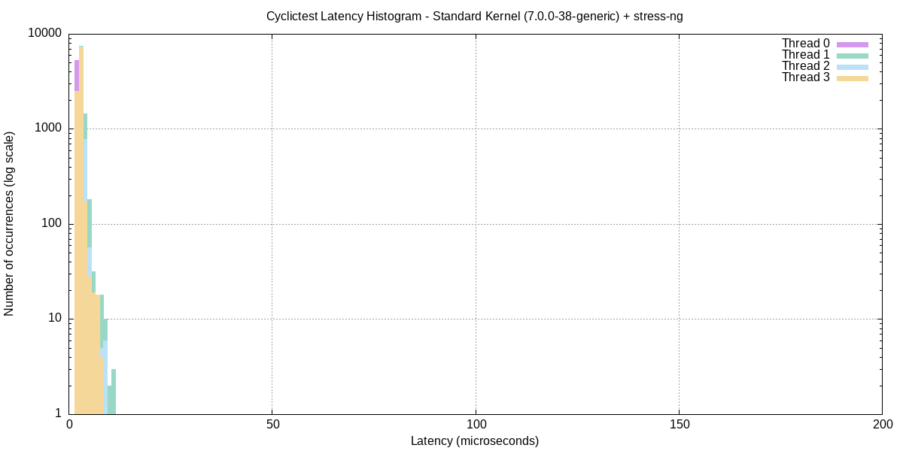

# LAB-03 – Results

[README](README.md) · [Tiếng Việt](README.vi.md)

All numbers below are extracted from the files in [`logs/`](logs/).

## Part A – Remote GDB (`logs/gdb_session.txt`)

| Bug | Evidence in the session |
|---|---|
| Array out-of-bounds | stopped at `i == len`; `data[i]` = – (garbage past `arr[4]`) |
| Use after free | `x/s buf` after `free()` → – |
| Integer overflow | `result` = –, true product = – |

## Part B – Valgrind

| | Before fix | After fix |
|---|---|---|
| definitely lost | 16,900 bytes in 250 blocks | none |
| indirectly lost | 0 bytes in 0 blocks | none |
| possibly lost | 0 bytes in 0 blocks | none |
| still reachable | 0 bytes in 0 blocks | none |
| heap usage | 352 allocs, 102 frees, 21,124 bytes allocated | 352 allocs, 352 frees, 21,124 bytes allocated |
| errors | 3 errors from 3 contexts (suppressed: 0 from 0) | 0 errors from 0 contexts (suppressed: 0 from 0) |

After the fix: **All heap blocks were freed -- no leaks are possible.**

## Part B.5 – `/proc/PID/status` on the ARM target

| Field | Before allocation (T=1s) | After leak (T=5s) |
|---|---|---|
| VmSize | 628 kB | 628 kB |
| VmRSS | 4 kB | 4 kB |
| VmData | 152 kB | 152 kB |

## Part C – strace / perf

`strace -c` (host, top syscalls):

```
% time     seconds  usecs/call     calls    errors syscall
------ ----------- ----------- --------- --------- ----------------
  0.00    0.000000           0         2           read
  0.00    0.000000           0        70           write
  0.00    0.000000           0         4           close
  0.00    0.000000           0         5           fstat
  0.00    0.000000           0        14           mmap
  0.00    0.000000           0         4           mprotect
100.00    0.000000           0       120         2 total
```

`time ./perf_target` (host): real 0m0.023s, user 0m0.022s, sys 0m0.001s

`perf report` hottest symbols:

```
56.78%  [.] __ieee754_log_fma                  libm.so.6             -      -            
    20.74%  [.] heavy_compute                      perf_target           -      -            
    12.57%  [.] log@@GLIBC_2.29                    libm.so.6             -      -            
     3.78%  [.] log@plt                            perf_target           -      -            
     1.30%  [k] _raw_spin_lock                     [kernel.kallsyms]     -      -            
               0x300000002
     1.26%  [k] qi_submit_sync                     [kernel.kallsyms]     -      -            
               0x40c45c8000000000
     1.26%  [k] kmem_cache_alloc_noprof            [kernel.kallsyms]     -      -            
     0.76%  [k] lock_vma_under_rcu                 [kernel.kallsyms]     -      -            
               0x300000002
     0.52%  [k] flush_tlb_mm_range                 [kernel.kallsyms]     -      -            
     0.42%  [k] build_id_parse_nofault             [kernel.kallsyms]     -      -            
     0.30%  [.] get_common_cache_info.constprop.0  ld-linux-x86-64.so.2  -      -            
     0.17%  [k] copy_mc_enhanced_fast_string       [kernel.kallsyms]     -      -
```

`perf stat`:

```
                 3      context-switches                 #    149.3 cs/sec  cs_per_second     
             20.10 msec task-clock                       #      0.2 CPUs  CPUs_utilized       
             4,792      cpu_core/branch-misses/          #      0.0 %  branch_miss_rate         (97.67%)
        76,131,907      cpu_core/cpu-cycles/             #      3.8 GHz  cycles_frequency       (97.67%)
       376,561,305      cpu_core/instructions/           #      4.9 instructions  insn_per_cycle  (97.67%)
           280,454      cpu_atom/branch-misses/          #      5.2 %  branch_miss_rate         (2.03%)
        40,536,038      cpu_atom/cpu-cycles/             #      2.0 GHz  cycles_frequency       (2.33%)
        26,541,548      cpu_atom/instructions/           #      0.7 instructions  insn_per_cycle  (2.33%)
       0.113820857 seconds time elapsed
```

Flame graph: [`logs/flamegraph.svg`](logs/flamegraph.svg)

## Part D – cyclictest (standard kernel + stress-ng)

Kernel: `Linux tung-pham 7.0.0-38-generic #38-Ubuntu SMP PREEMPT_DYNAMIC Fri Sep  4 09:10:14 UTC 2026 x86_64 GNU/Linux`

| Thread | Min (µs) | Avg (µs) | Max (µs) |
|---|---|---|---|
| 0 | 2 | 2 | 12 |
| 1 | 2 | 3 | 14 |
| 2 | 2 | 2 | 10 |
| 3 | 2 | 2 | 12 |

Histogram overflows (> 200 µs): `00000 00000 00000 00000`



